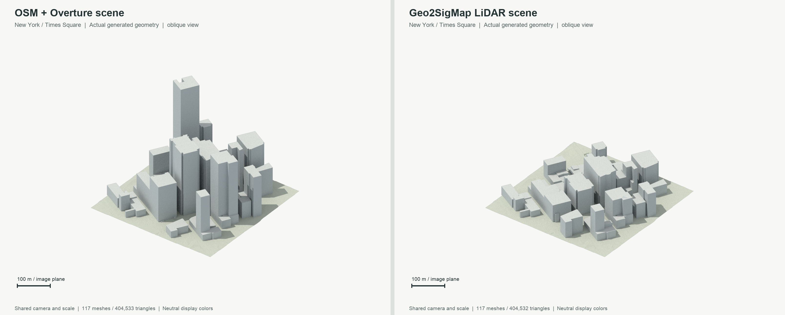
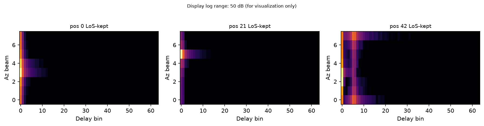

# Digital Twin–Based Wireless Positioning

The public repository for our ongoing research in digital twin–based wireless positioning: from geographic data to simulated radio fingerprints and position estimates. Code, examples, and results are added continuously as the work progresses.

[Setup](docs/setup.md) · [Quickstart](docs/quickstart.md) · [Scene sources](docs/scene-sources.md) · [Repository guide](docs/structure.md)

## Scene examples

Generate scenes with Geo2SigMap/OpenStreetMap, Overture height fallback, LiDAR/DEM terrain, or BostonTwin; existing Mitsuba XML scenes are also supported.

*Times Square, New York: the same OSM footprints and USGS terrain, with different building-height sources. Overture enriches the Geo2SigMap route. © [OpenStreetMap contributors](https://www.openstreetmap.org/copyright), Overture Maps Foundation; USGS, NOAA, and Microsoft source data. [Figure details and credits](docs/visual-examples.md).*

## From scenes to positioning

**Pipeline:** scene → transmitter/receiver placement → ray tracing → path refinement and link budget → channel taps → beam-delay fingerprints → positioning.

Sionna RT simulates propagation; receiver processing turns channel responses into spatial fingerprints. The current release includes preprocessing and weighted k-NN positioning. Our ongoing work also studies CNNs that combine fingerprints from multiple base stations.

*Example fingerprints from [the complete runnable pipeline](docs/quickstart.md); color shows a 50 dB display range.*

## Example research results

*One BostonTwin scene, 3,841 held-out positions, four base stations, and three training seeds. Points show mean error with sample standard deviation across runs. [Evaluation details and per-run metrics](docs/results.md).*

These are simulation results from ongoing research. The CNN training code, weights, and study dataset are not yet included in this release.

**Contributors:** [Canan Cebeci](https://github.com/canancebeci) and [Josef Ullrich](https://github.com/josefullrich).

**License:** [CC BY-NC 4.0](LICENSE). Third-party code and data retain their [own terms](NOTICE.md).
