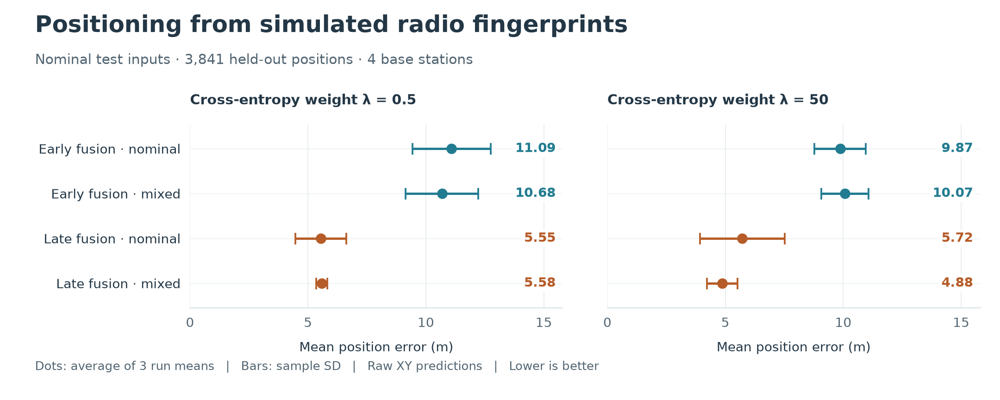

# Example positioning results

Snapshot: October 26, 2026. These results illustrate ongoing research with the
pipeline; the CNN training code, weights, and study dataset are not yet included
in this release. The public [synthetic k-NN example](quickstart.md) is a separate
pipeline demonstration.



The figure includes all 24 nominal evaluations in this snapshot: two CNN systems,
two training recipes, two cross-entropy weights, and three training seeds.
For each setting, the dot is the arithmetic mean of the three runs' mean 2D
Euclidean position errors; the bar is their sample standard deviation. It is
neither a confidence interval nor an ensemble result. Lower error is better.

## Evaluation setup

- **Scene and signals:** one BostonTwin urban scene in the Cambridge Street
  area; four base stations; simulated uplink at 14 GHz with 300 MHz bandwidth.
  Each observation contains 64 beams × 256 delay bins × 4 base-station channels.
- **Positions:** 20,000 sampled outdoor users; 19,201 retained after excluding
  799 locations with no usable link upstream. The shared position-grouped split
  contains 13,440 training, 1,920 validation, and 3,841 test positions (split
  seed 71). Repeated views of a position stay in the same split.
- **Training:** seeds 71, 72, and 73 share that split. “Nominal” uses nominal
  observations; “mixed” samples 50% nominal and 50% cached synthetic perturbation
  views at the same training positions. Perturbations cover directional path
  removal/attenuation, cluster-gain changes, station dropout, and combinations.
  Validation data select checkpoints; test scores do not select checkpoints.
- **Systems:** C03 performs early fusion with common-peak normalization across
  base stations. I-joint performs late fusion with separate per-station
  normalization and joint individual/fused supervision. Both use a coordinate
  MSE plus cross-entropy objective, with CE weight λ = 0.5 or 50; I-joint also
  weights its auxiliary individual-head supervision by 0.3.
- **Coordinates:** softmax-weighted expected position over 7,246 eligible outdoor
  centers on a 2 m grid. The figure reports raw XY predictions before outdoor
  correction. Every nominal evaluation has 3,841 finite predictions and no
  no-fix cases; this does not include the 799 upstream coverage exclusions.

## Interpretation

The nominal test uses held-out positions within the same scene, not an unseen
city or field measurements. The receiver roster has also appeared in earlier
project studies. These scores alone do not establish real-world performance,
transfer between scene sources, or robustness to environmental changes.

The systems differ in normalization and supervision as well as fusion, so this
is a comparison of complete systems. C03 runs use A100-SXM4-40GB GPUs; I-joint
seeds 71/73 use A40 and seed 72 uses A100-SXM4-40GB. The λ = 0.5 nominal-trained
I-joint seed-72 evaluation disables TF32; the other evaluations retain default
precision settings. Variation across runs is therefore not solely a seed effect.

## Data and figure reproduction

[Per-run metrics](results/nominal-positioning-2026-10-26.json) contain the exact
values underlying the figure, including raw and outdoor-corrected metrics and
model/prediction hashes. Only nominal test results are presented here; perturbed
and outage evaluations are outside this example's scope.

Regenerate the figure from the repository root in the pipeline environment:

```bash
python docs/plot_results.py
```

This replots the saved metrics; it does not train or evaluate a model.
